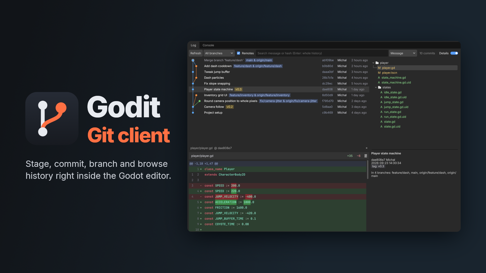

# Godit

[](https://github.com/rychtar/godit/actions/workflows/tests.yml)

A git client inside the Godot editor. Stage, commit, switch branches and browse history without leaving the editor.



## Features

- **Changes panel**: stage files, folders or single lines with a checkbox, then commit or push. Fits a side dock down to 200 px.
- **Quick commit**: `Alt+C` opens a small commit window from anywhere, with the dock closed: tick the files, type the message, Commit or Commit and Push.
- **Changelists**: group changes and commit or shelve them separately.
- **Diff view**: side by side or unified, with syntax colors. Images side by side, with a swipe line or as an onion skin.
- **Godit tab**: any diff full size next to 2D, 3D and Script, with hunk and line staging.
- **Script editor**: changed lines in the gutter with one-click rollback, the changed words highlighted, optional blame.
- **Inspector and Scene dock**: a property changed since the last commit shows its old value with Revert; added and changed nodes are colored.
- **Commit check**: a warning when a staged scene, resource or script references a file the commit won't contain (not added, deleted, or different letter case, which breaks on Linux).
- **Branches**: switch, merge and rebase. Fetch, pull and push run in the background.
- **Branch in the toolbar**: the current branch next to the run buttons with its commits to push (↑) and pull (↓), whichever dock is open. Click it, type a few letters and press Enter to switch, or create a new branch right there.
- **Git Log**: commit graph with search and cherry-pick. Edit Commit and Interactive Rebase rewrite history; Open This Version shows a scene as it was.
- **Console**: every git command Godit ran, and a prompt for your own. Risky commands ask first, and error dialogs jump to the command that failed.
- **Conflict resolver**: pick Ours, Theirs or both, side by side.
- **FileSystem dock**: changed files are colored and marked with git's letter (M, A, D, R, ?, !); right-click for history, revert, add or ignore.
- **GitHub, GitLab, Bitbucket**: open a commit, file line or branch in the browser, or start a pull request.

## Install

1. Install Godit from the Asset Library, or copy `addons/godit/` into your project's `addons/` folder.
2. Enable **Godit** in Project Settings > Plugins.

You need Godot 4.4+, `git` on your `PATH`, and a project inside a git repository.

For push and pull, git has to log in without asking: use a credential helper for HTTPS or `ssh-agent` for SSH. If `git push` works in a terminal without a prompt, it works in Godit.

If `addons/godit/` is in your repository and a checkout, pull or reset changes it (a teammate updated Godit, or an older branch has an older version), Godit offers to restart the editor, since reloading its own scripts while it runs can crash Godot.

## Usage

- **Where**: Godit opens as one SourceTree-style dock in the bottom panel: File Status, History and Console on the left with your branches under them. On Godot 4.6+ drag it to a side dock or make it floating, e.g. on a second monitor, and it stays there. The button at the left of its toolbar hides the sidebar, the one at the right switches the layout. Dividers stay where you drag them. The dock's title counts the changed files, "Godit (5)", and turns yellow while there are commits to pull and red on conflicts, so you see it behind other tabs too. Narrower than 480 px, Changes leaves the diff out: right-click a file, Show Diff in the Godit Tab.
- **Keyboard**: `Ctrl/Cmd+1` to `4` open File Status, History, Branches and Console, `Alt+G` shows or hides the Godit dock, `Alt+C` opens the quick commit window. Every Godit command is in the Command Palette (`Ctrl/Cmd+Shift+P`, type "godit"): commit, fetch, pull, push, switch branch, the layouts, blame, settings, history of the open scene or script. On Godot 4.5+ bind or change their keys in Editor Settings > Shortcuts > Godit.
- **Commit**: tick files in **File Status**, type a message and press `Ctrl/Cmd+Enter`. Add `Shift` to also push. From anywhere else, `Alt+C` opens the same in a small window.
- **Stage part of a file**: open its diff and stage a hunk or selected lines.
- **Changelists**: double-click one to make it active and drag files between them.
- **Branches**: double-click one to switch; right-click it to merge, rebase or push, or right-click a section header to add a branch, tag or remote. Or click the branch in the editor's toolbar, type a few letters and press Enter.
- **History**: the commit graph, with search, cherry-pick and history editing. Right-click a commit to edit it or rebase from it, or a file to open its version from then.
- **Big diffs**: turn on the Godit tab in Godit Settings > Layout. It sits next to 2D, 3D and Script; the expand button above a diff opens the diff there, and while the tab is open, a file clicked in Changes or Git Log shows there.
- **Everything else**: right-click a file, branch or commit.

## Settings

**Godit Settings** (Project > Tools > Godit > Settings…, the ⋮ menu in the docks, or "Godit: Settings…" in the Command Palette) lists every option with a line on what it does, a filter and Reset per section: the layout (one combined dock by default, a Git dock plus Git Log, or both in the bottom panel), the Godit tab, auto-staging and auto-adding new files with the masks for files to skip (for example `*.psd` source art), diff options, History columns, blame, changes in the Inspector, background fetch and auto-save with their intervals, auto-reload, and a faster `git status` for large projects (git's file system monitor). Tools > Godit keeps the layout and the most used switches.

Your preferences are kept for all your projects, in the editor's settings folder. The masks are saved in `project.godot`, so the whole team shares them. The open view and the divider positions stay per project. `.import` and `.uid` files are added with the file they belong to, since Godot needs them in the repo.

## Tests

Run from the project folder (needs Godot 4.4+ and `git`, no other dependencies):

```
godot --headless --path . --script tests/run_tests.gd
```

Every `tests/test_*.gd` file is a test file, every method starting with `test_` is a test. The exit code is 1 when a test fails.
The git tests work in throwaway repositories in the temp folder, with git's own config set aside. They run on every push on Linux with Godot 4.4, 4.5, 4.6 and 4.7, and on Windows and macOS with 4.4 and 4.7 (see `.github/workflows/tests.yml`).

## License

MIT, see [LICENSE](LICENSE).
